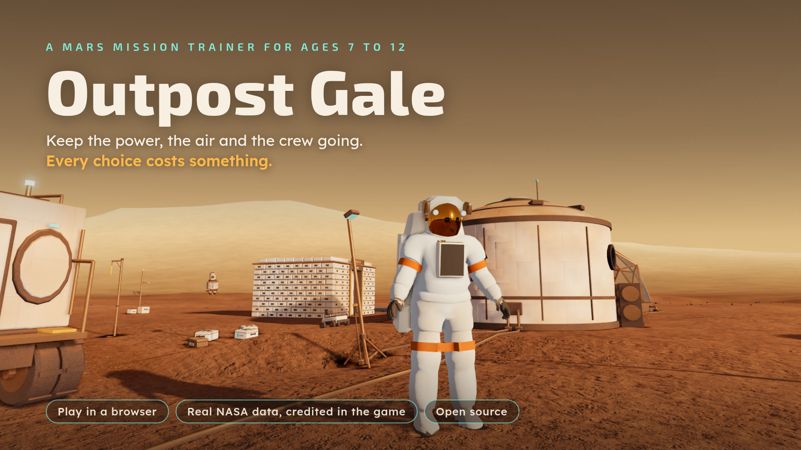
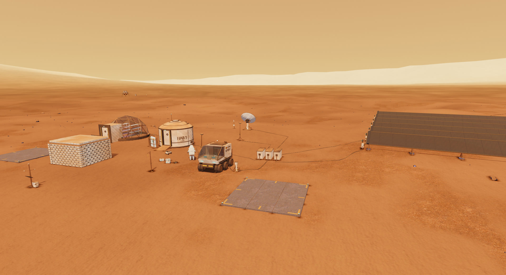
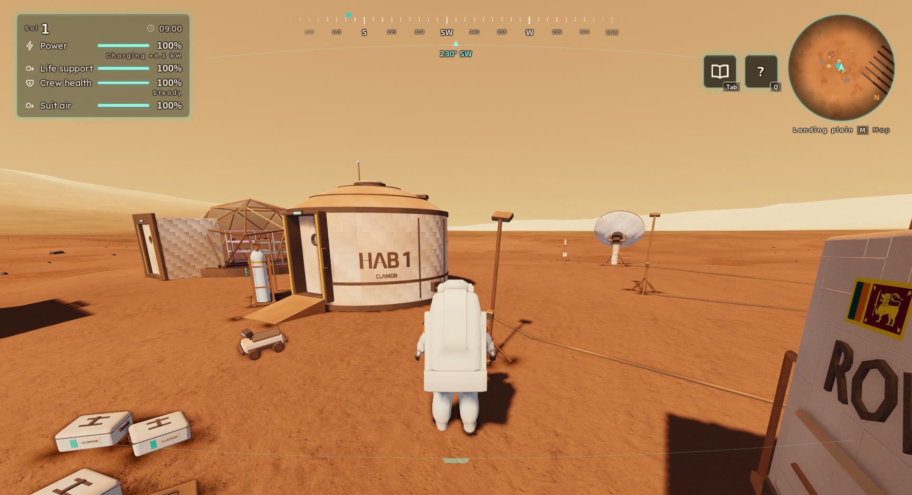
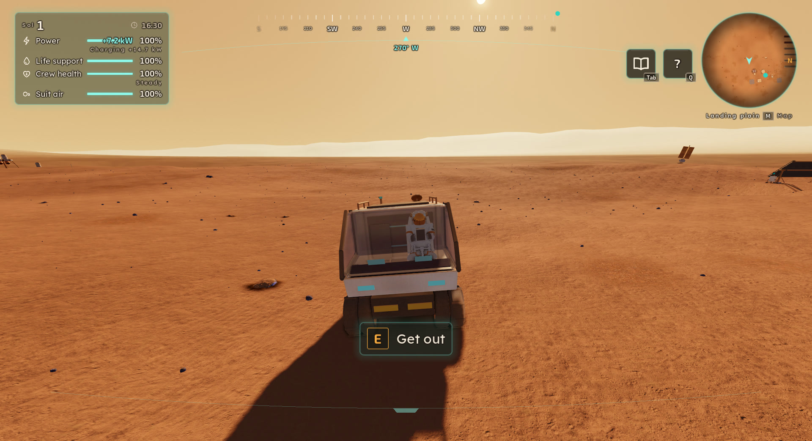
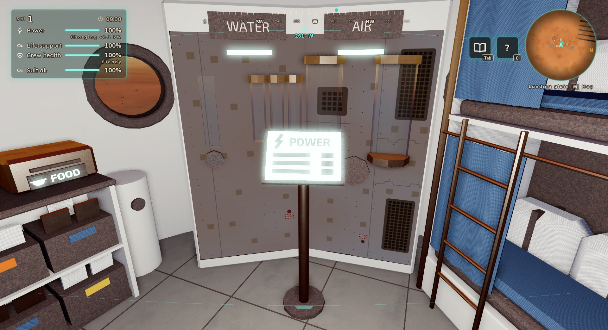
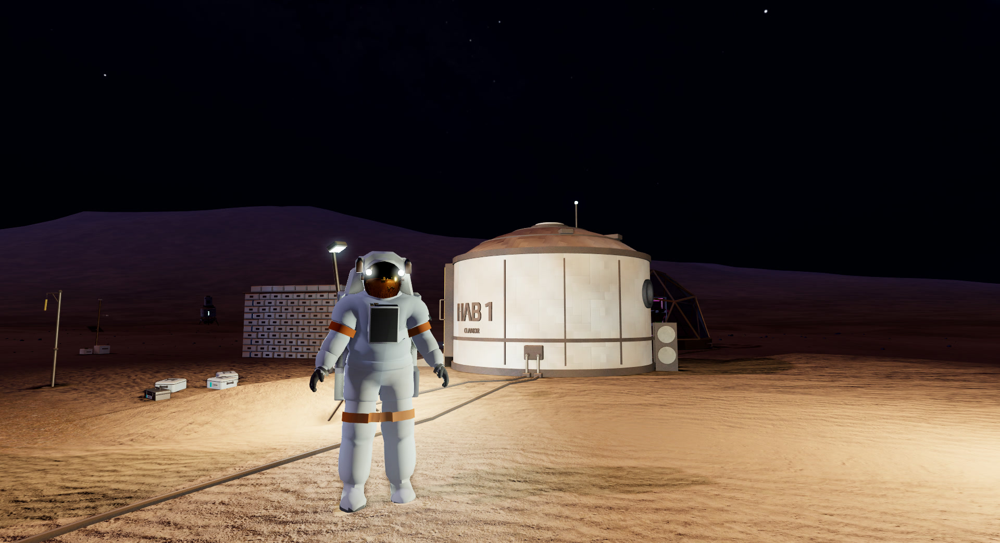
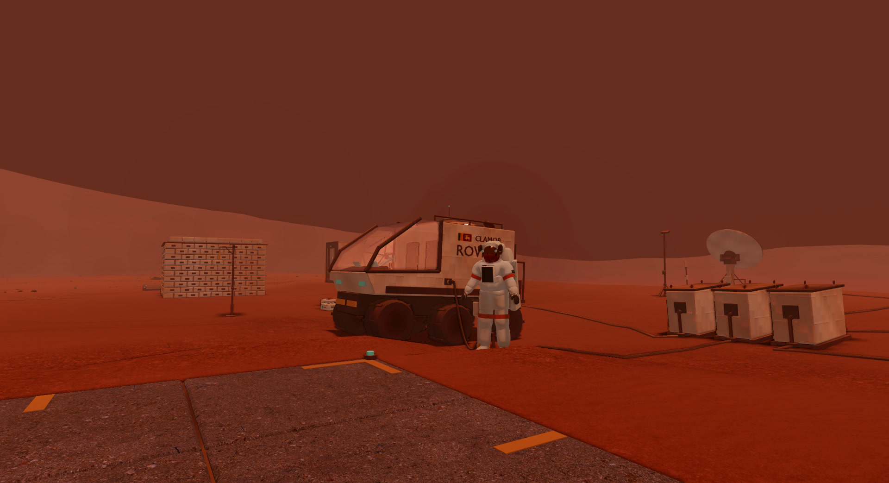

# Outpost Gale

Outpost Gale is a third-person game for kids aged 7 to 12. You are the commander of a small base in Gale crater on Mars, with a helper rover called PIP at your side. You keep the power on, the air flowing and yourself alive, one sol at a time.

**Nothing is free.** Every choice in the game costs something, the mission can be lost, and when it is, the game shows you the choices that led there and lets you try the sol again.

It is Team Clamor's entry for the challenge "Build a Junior Astronaut Mission Trainer", NASA Space Apps Challenge 2026, Colombo.

## What you get

- **A real place.** The ground under your boots is Gale crater's real shape, built from HiRISE elevation models. The base, the rover and the suit are sized from published figures, each with its source in `data/reality.json`.
- **Four bars, and no more.** Power, Life support, Crew health and Suit air. Each one says what is pulling it down, and one key opens a report of what makes and uses power, how long each supply lasts and what your body needs.
- **Choices with a price.** Run the air maker or grow plants. Stay in the storm shelter or go. Decide what gets power when a dust storm covers the solar wings. Each answer changes the numbers, and some answers lose the mission.
- **Needs you can feel.** Suit air runs down outside. Thirst, hunger and tiredness cost Crew health. You drink, eat, refill and sleep by walking to the thing and holding one key.
- **Real space weather.** The solar storm in the game is the one of 20 May 2024, with the readings Curiosity's own radiation detector took at Gale that day. Every data value is labelled ARCHIVED with its date, and one key shows where it came from.
- **A radio that takes its time.** Ask Earth a question and the answer does not come at once. Meanwhile the oxygen is still leaking.
- **A handbook that grows.** Each fact appears in the handbook once the game has taught it, in plain words, with a "kid version" and its source.
- **Runs almost anywhere.** In a browser on a laptop or a phone, with no login, or as an offline download for Windows, Linux and macOS.

## Play it

**In a browser:** [clamor-nasa-space-apps.github.io/sandbox](https://clamor-nasa-space-apps.github.io/sandbox/). Nothing to install.

**Offline:** download the build for your computer from the [latest build](https://github.com/Clamor-NASA-Space-Apps/outpost-gale/releases/tag/build-sandbox) and run it.

| Key | What it does |
|-----|--------------|
| `W` `A` `S` `D` | Walk, or drive the rover |
| Mouse | Look around |
| `Shift` | Hurry (it tires you out) |
| `Space` | Hop |
| `E` | Use what is in front of you. Hold it to drink, eat, refill air or brush off dust |
| `R` | The base report: what earns and what costs |
| `Tab` | The handbook |
| `Q` | Where the numbers come from |
| `M` | The map |
| `H` | Helmet lights |
| `Esc` | Settings |

On a phone the game shows a stick and buttons instead.

## Screenshots

<table>
  <tr>
    <td width="33%" align="center"> The base</td>
    <td width="33%" align="center"> On foot</td>
    <td width="33%" align="center"> In the rover</td>
  </tr>
  <tr>
    <td width="33%" align="center"> Inside HAB 1</td>
    <td width="33%" align="center"> Night</td>
    <td width="33%" align="center"> Dust storm</td>
  </tr>
</table>

All pictures are captures of the game itself.

## Mission 1, sol by sol

Mission 1 is ten sols. It is the part of the game that is finished.

| Sol | What you do | What it is about |
|-----|-------------|------------------|
| 1 | Meet PIP, learn to move, tour the base, choose between the air maker and plants, then fill your suit, drink, eat and sleep | The four bars and your own needs |
| 2 | Check the Power meter, run a solar wing's wiper, walk to the reactor | Where power comes from, and dust |
| 3 | Visit the greenhouse and plant a seed tray | Food that takes time |
| 4 | An oxygen leak: ask Earth, fix the valve, read Earth's answer | Life support and radio delay |
| 5 | A solar storm: get to the storm shelter, then decide to stay or go | Radiation |
| 6 to 8 | Quiet sols, which you can skip | |
| 9 | Plan a trip on the map, drive to Mont Mercou, take a rock sample, drive home | Exploring, and getting back |
| 10 | A dust storm darkens the sky: choose what gets power | Trade-offs under pressure |

## What is real

Every number a player sees has a source, or says plainly that it is a game rule. The sources are one key away in the game (`Q`), and in the handbook.

| In the game | Where it comes from |
|-------------|---------------------|
| The shape of the ground | HiRISE digital terrain models. NASA/JPL/University of Arizona, USGS |
| The solar storm of 20 May 2024 | NASA DONKI, through NASA Open APIs |
| Radiation at Gale before and during that storm | Curiosity's RAD detector, from NASA OSDR RadLab |
| Air, water and food a person needs | NASA's life-support baseline figures |
| The photos in the handbook | NASA image library, each credited on its page |

All data in the game is archived and dated. None of it is presented as live. Data and photos: NASA. NASA does not endorse this project.

## How it is built

- **Godot 4.7, GDScript only**, the Compatibility renderer, shipped as a single-threaded web export so it runs in a phone's browser.
- **The rules are separate from the scene.** `sim/` holds the game's rules as plain scripts with no nodes, and `data/sim.json` holds every number with a note on its source. The world and the HUD only read the rules' state.
- **The world is data.** `data/world.json` places every building, prop and use spot. The story is data too: `data/beats.json` and `data/sols.json`.
- **Tests run without a screen.** 40 headless test files cover the rules, the story from Sol 1 to Sol 10 played by a bot, the HUD, saving, the camera and the world. `godot --headless --fixed-fps 60 --path . -s tests/sim_test.gd` runs one.
- **Every push is built** for the web, Windows, Linux and macOS by GitHub Actions.

`AGENTS.md` has the map of the code and the rules the project follows.

## Good to know

> [!NOTE]
>
> **What was prepared before the event.** With the Colombo organisers' permission, the research, the look, the models, the world and the game's systems were prepared before 14 November 2026, and the story was drafted. At the event, on 14 and 15 November, the story was wired in, the survival rules were built, and the game was playtested and fixed. The commit history shows what came when.
>
> **AI use.** The game was built with AI assistance (Claude, by Anthropic) for code, research and fact-checking. The idea, the design and the story are the team's. Every use is described on the project page.
>
> **This README** was rewritten on 16 November 2026, after submission. The game is as it was submitted.

## What is next

Planned, not built yet:

- **Missions 2 and 3**, Sols 11 to 30.
- **VR mode:** put on a headset and stand on Mars yourself.
- **Branching missions:** a wrong choice opens a new mission. Wire the power wrong on Sol 10 and the base goes dark, then fix it yourself or ask Earth and wait.

## Credits

- [Godot Engine](https://godotengine.org), the engine.
- NASA, for the data, the terrain, the photos and the reference models. NASA does not endorse this project.
- [Kenney](https://kenney.nl), [Quaternius](https://quaternius.com) and [Poly Haven](https://polyhaven.com), for CC0 models and textures.
- [Freesound](https://freesound.org) contributors, for sounds.
- [Exo 2](https://fonts.google.com/specimen/Exo+2) and [Lexend](https://fonts.google.com/specimen/Lexend), the typefaces, under the SIL Open Font License 1.1.

`ASSETS.md` lists every asset the game ships, with its source and licence.

## Licence

Original work: [Apache License 2.0](https://www.apache.org/licenses/LICENSE-2.0). Third-party assets keep their own licences, listed in `ASSETS.md`. Copyright (C) 2026 Team Clamor.
